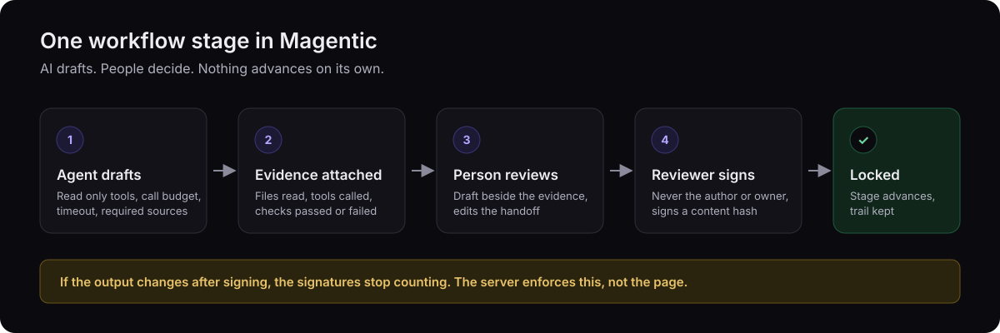
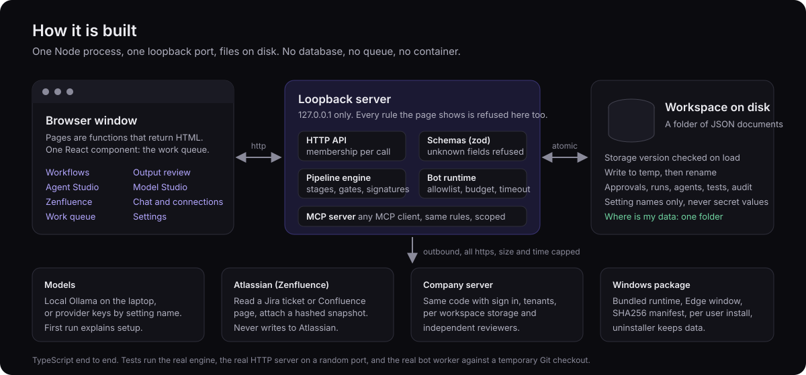
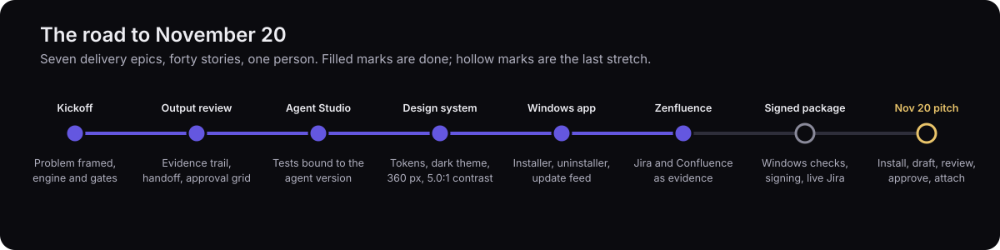

<p align="center">
  
</p>

# Magentic

**AI drafts. People decide. Every approval is a signature over a content hash.**

A supervised workflow workspace for teams that may use AI only with a chain of custody. Built as a one person project for the Virginia Tech x Accenture Federal Services Build Challenge. Pitch on November 20, 2026.

<p>
  
  
  
  
  
  
</p>

## The thirty second version

- **Problem.** In federal delivery, an AI output is usable only if you can show where it came from, who reviewed it, and that nothing changed afterwards. Chat tools leave that to the person.
- **Answer.** Magentic puts the chain of custody in the software. An agent drafts a stage, the evidence sits beside the draft, a person edits, a second person signs, and the server refuses anything that skips a step.
- **Shape.** One TypeScript process, a browser window, files on disk. Runs on a laptop with a local model or on a company server with tenants. Ships as a Windows installer.

## By the numbers

| Source files | Test files | Lines | Tests | Failures | Jira epics | Jira stories | Lowest contrast |
|:---:|:---:|:---:|:---:|:---:|:---:|:---:|:---:|
| 116 | 103 | 27,800 | 724 | 0 | 7 | 40 | 5.0:1 |

Counts are from the workbench on branch `codex/published-main-preview`; six tests are skipped because they need a live model.

## What a person can do today

| Area | Outcome | Proof |
|---|---|---|
| Workflows | Start a run and see, per run, the stage, the owner, the output state and the one next action | [`workflow-view.ts`](workbench/workflow-view.ts) |
| Output review | Evidence, original output, edited handoff and approval state in one grid | [`output-review.ts`](workbench/output-review.ts), [test](tests/output-review.test.ts) |
| Approval gates | Independent signatures over a content hash; owner and author can never approve their own stage | [`pipeline.ts`](workbench/pipeline.ts), [test](tests/workspace-focus.test.ts) |
| Agent Studio | Build an agent, grant read only tools with limits, save tests bound to its version, assign to a stage only after a pass | [`agent-tests.ts`](workbench/agent-tests.ts), [gate test](tests/agent-assignment-gate.test.ts) |
| Model Studio | Train, evaluate, approve and assign an assistant through six guided stages | [`guided-stages.ts`](workbench/guided-stages.ts) |
| Zenfluence | Attach a reviewed, hashed snapshot of a Jira ticket or Confluence page; read only | [`zenfluence.ts`](workbench/zenfluence.ts), [guide](docs/zenfluence.md) |
| Windows app | Installer with SHA256 manifest, Apps and features entry, uninstaller that keeps data, update feed check | [`workbench/desktop`](workbench/desktop) |
| MCP server | The same operations for any MCP client, scoped to one workspace | [`pipeline-mcp.ts`](workbench/pipeline-mcp.ts) |

## Rules the server enforces

Shown in the interface and refused by the server when a client skips the interface.

1. Every API call is checked for current membership of the workspace it names.
2. An agent that must read a source and does not is failed; the evidence block lists each file as read, empty or missing.
3. Approvals sign a content hash. Change the content and the signatures stop counting.
4. An agent version with no passing test cannot be assigned to a stage (HTTP 409).
5. Credentials are setting names in configuration, never values. Nothing echoes a key to a page or a log.
6. Outbound reads are https only, size capped, time capped, redirects refused, and checked against what was asked for.

## How it is built

<p align="center">
  
</p>

Four decisions worth asking about:

- **Files, not a database.** A workspace is a folder of JSON with a storage version and atomic writes. The Windows package is a bundled runtime and a browser window, nothing to install beside it.
- **Schemas at every boundary.** Request bodies, stored documents and configuration files are parsed with zod. A file written by a newer version is refused with a message, never rewritten in silence.
- **Views as functions.** Pages return HTML strings, so a view test renders a page for owner, reviewer and viewer and asserts on the words each one may see. The one interactive list is a React component.
- **Honest states.** Every page shows loading, empty, error, not connected, not assigned, blocked and awaiting approval, each with the one step that resolves it. A stopped local model is a setup notice, not a red error.

## How the work is run

Every change takes the same path: a Jira story with acceptance criteria, a written plan, code in an isolated copy with new tests only, four verification scripts with counts recorded, a diff on the story before anything is applied, hash checked writes, then a second verification on Windows and a look at the result at 1440 and 360 px.

Seven delivery epics and forty stories carry that trail. Decisions that need a product owner (code signing, Foundry tenant, design system path) are their own tickets with the options written out, so nothing blocks in silence.

## Verify it in ten minutes

Windows PowerShell, in the repository folder, Node 22:

```
corepack enable
corepack pnpm install --frozen-lockfile
corepack pnpm typecheck
corepack pnpm test
corepack pnpm build
corepack pnpm build:workbench
node .\workbench\dev.mjs --port=4182
```

Then open `http://127.0.0.1:4182` and try three things:

1. Open a run on Workflows. The evidence block names every source as read, empty or missing, and the approval block shows who may sign and who may not.
2. In Agent Studio, change a tested agent and try to assign it. The control is disabled and the API answers 409.
3. Stop Ollama and open Chat. You get the setup steps, not an error.

The installer is `corepack pnpm build:desktop`, then `Install.cmd` in the output folder.

## The road to November 20

<p align="center">
  
</p>

| Remaining | Status |
|---|---|
| Windows verification of the current tree and the first installable package | queued |
| Live Zenfluence read against the company Jira project | credentials pending |
| Update install and rollback scripts; code signing decision | in progress |
| Pitch path: install, connect a model, draft, review, approve with a second account, attach a Jira ticket | scripted |

## What this shows

- Full stack ownership: engine, HTTP API, MCP server, interface, Windows packaging, release workflow, documentation.
- A non negotiable (auditable human approval) kept intact through forty tickets of change.
- Verification as a habit: 724 tests, measured contrast and keyboard order, hash checked writes, counts recorded per environment.
- Delivery team practice as a team of one: epics, stories with acceptance criteria, plan before code, diff before apply.

## About

Built by a Virginia Tech CMDA student, class of 2027. Walkthrough and source tour on request through the repository contact.
