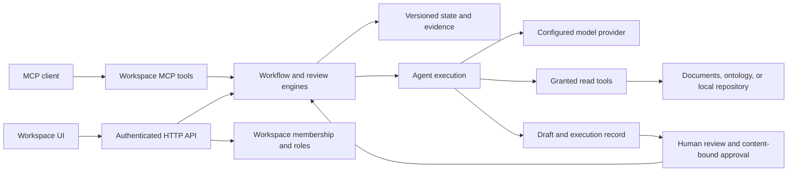

# Magentic.AI

**Full-stack engineering project: supervised AI workflows, company workspaces, and MCP integration.**

Magentic turns an AI-assisted task into a recorded workflow: a person defines the work, an agent produces a draft with evidence, and an eligible reviewer approves the handoff. The repository contains the workspace application, execution engines, MCP interfaces, and packaging tools.

The engineering focus is controlling what an agent can access and do, preserving the evidence behind its output, and enforcing those rules on the server. Current status: a working prototype with local and company execution modes.

[Company workflow](#how-a-company-uses-it) · [Stack](#technology-stack) · [Run locally](#run-locally) · [Documentation](docs/README.md) · [Previous product narrative](docs/product-overview.md)

**Presentation and submission:** [open the website source](docs/site/index.html) or run `node docs/site/serve.mjs --port=4184` and visit [the local presentation](http://127.0.0.1:4184/). It includes a seven-step interactive walkthrough, a frontend/backend architecture explorer, and verification and limitation notes. The walkthrough uses synthetic records and simulated reviews; it makes no model or integration calls. See the [presenter guide](docs/site/README.md) for the live application demo and submission checklist.

**Workspace** groups team work, personal work and eligible reviews, plus the shared agent library and stage assignments. Its **Controls** menu holds workflow checks, model connections, MCP access and company messaging. Review stage bindings and blockers, then export a report through [Workflow checks](docs/workspace-deployments.md); this does not provision cloud resources. [Slack](docs/slack.md) supports administrator-reviewed audit summaries and team updates through a configured company webhook.

## Engineering work demonstrated

| Area | Implementation | Evidence |
| --- | --- | --- |
| Full-stack application development | TypeScript HTTP services, workspace UI, structured request validation, and persistent workflow state | [Server](workbench/server.ts), [browser](workbench/browser.ts), [storage](workbench/storage.ts) |
| Company access and authorization | Clerk Organizations mapped to separate workspaces; current membership and effective roles checked by the backend | [Company access](workbench/company-access.ts), [isolation tests](tests/company-workspaces.test.ts) |
| Agent execution | Bounded model/tool loops, explicit tool grants, source-read requirements, and reviewable proposals | [Worker](workbench/bot-worker.ts), [policy](workbench/bot-schema.ts), [runtime](workbench/bot-runtime.ts) |
| Review and release controls | Versioned workflow configuration, content-bound approvals, and rejection of new assignments with unresolved quality reviews | [Pipeline](workbench/pipeline.ts), [assignment tests](tests/agent-quality-assignment.test.ts), [registry](registry/record.ts) |
| Data integration | Typed ontology ingestion from CSV, link validation, source hashes, and read-only MCP access | [Ingestion](workbench/ontology-ingest.ts), [dataset tests](tests/ontology-dataset.test.ts), [ontology guide](workbench/ONTOLOGY.md) |
| Testing and delivery | Node test suite, UI/accessibility test tooling, separate application builds, Windows packaging, and a VS Code extension | [Scripts](package.json), [tests](tests/), [desktop tooling](workbench/desktop/), [extension](extensions/vscode/) |

## Technology stack

| Technology | Where and why it is used |
| --- | --- |
| **TypeScript 5.9 · Node.js 22 · ESM** | Shared types across HTTP handlers, workflow engines, MCP tools, and browser code. Relative TypeScript imports use `.js` specifiers for the emitted modules. |
| **pnpm 10.26.1 · Corepack** | Pinned package management and reproducible installation from the lockfile. |
| **MCP TypeScript SDK** | Workspace tools for compatible clients and in-memory tool connections for agents. Tool access remains subject to workspace scope and policy. |
| **Zod 3** | Validates configuration, requests, stored records, and integration payloads at boundaries. |
| **HTML · CSS · browser TypeScript · React 19** | Most views are HTML-rendering functions with shared design tokens. React powers the interactive operations queue. |
| **esbuild** | Bundles browser assets and Node entry points for local, demo, company, and MCP execution. |
| **Ollama · optional LangChain adapters · configured provider APIs** | Local and hosted model execution through provider interfaces. Models require an installed adapter and valid connectivity; a model name alone does not connect it. |
| **Clerk Organizations** | Company sign-in and membership. Provider roles map to Magentic's author, approver, and administrator roles. |
| **Stripe** | Configured subscription checkout and billing portal integration. Payment does not create workspace membership. |
| **JSON persistence · Node filesystem APIs** | Workspace state, versioned configuration, and execution records with atomic writes. The company service currently uses one writer per data directory. |
| **Git worktrees** | Isolates local repository proposals from the developer's checkout. A worktree is not an operating-system sandbox. |
| **Node `--test` · Playwright · axe-core** | Domain/API regression tests plus separate browser and accessibility checks. The standard test command does not run every UI or live-provider check. |

Optional integration boundaries include Palantir Foundry reads, Jira/Confluence evidence, and reviewed AWS Lambda invocation. Each requires its own configuration and permissions.

## Architecture



There are three distinct execution surfaces:

| Surface | Intended use | Boundary |
| --- | --- | --- |
| **Local workspace** | Develop and test against a repository, inspect proposed changes, and run configured validation commands | Runs with the local user's privileges. Repository execution is supervised. |
| **Company workspace** | Shared documents, approved assistants, workflow runs, and independent review | Clerk membership selects access. Company data is scoped by workspace; host repository execution is not enabled. |
| **Standalone MCP adapters** | Expose supported tools to compatible external clients | The workspace endpoints and the original conversation-relay adapter are separate interfaces with different authentication requirements. |

Workspace MCP endpoints include `/api/mcp` for reviewed definitions and `/api/pipeline-mcp` for supported workflow operations. The original relay adapter uses a separately operated REST service; it is not required for the local workbench demo. See the [MCP/relay guide](docs/relay-adapter.md) before configuring that entry point.

## How a company uses it

**Example: an internal documentation request.** A delivery team needs an answer based on its SOP, with enough evidence for another employee to review it.

| Step | Employee action | What Magentic records or enforces |
| --- | --- | --- |
| 1. Join the company | Sign in through Clerk and select a company | Verified membership determines access. A company administrator provisions its workspace; display names and email domains do not grant access. |
| 2. Complete setup | Open **Workspace setup** and review roles, model configuration, references, and workflow settings | Setup reflects saved state. It does not certify provider connectivity or reviewer availability. |
| 3. Prepare the task | An author adds the SOP, attaches it to the work, and starts a workflow | The run retains its configuration and references. Documents with detected credentials cannot be used as model input through the document flow. |
| 4. Produce a draft | Use an approved assistant on a configured company workflow stage | The stage uses its saved model/profile binding and granted tools. Repository-agent templates require isolated workers before company execution can be offered. |
| 5. Review the evidence | Compare the draft with its sources, revise the handoff, and request review | Execution completion and answer quality are separate facts. A model response is not proof that the task is correct. |
| 6. Approve and hand off | Eligible independent reviewers approve the gated output | The run owner and output author cannot approve their own gated handoff. Approvals bind to the output content; a change invalidates that evidence. |

### Roles

| Magentic role | Typical responsibility |
| --- | --- |
| **Author** | Prepare tasks, add reference material, and start work. |
| **Approver** | Review evidence and approve eligible releases or handoffs. The UI also calls this role “Reviewer.” |
| **Administrator** | Configure workflows and workspace settings; manage company access through the identity provider. Administrative rights do not bypass independent approval rules. |

Roles can be combined. The default Clerk mapping is `org:admin → admin, author, approver`, `org:member → author`, and `org:reviewer → approver`. The reviewer role must exist in Clerk if that mapping is used. Unknown provider roles do not gain access.

For local repository agents, Agent Studio saves instructions, permitted tools, limits, and version-bound tests. Successful unreviewed tests remain assignable for compatibility. A recorded failed or uncertain quality review blocks new assignments until resolved for that version, or the agent is revised and tested again. This is distinct from Model Studio release approval.

### Other company use cases

- **Engineering handoff:** preserve a proposed change, validation results, and review decisions through planning, build, and delivery stages.
- **Operational evidence review:** attach a Jira ticket or Confluence snapshot through Zenfluence and compare it with workflow output.
- **Data-grounded analysis:** read typed objects and relationships from a local ontology dataset or configured Foundry environment.
- **Reviewed automation:** an authorized operator previews and invokes a configured Lambda unit from an independently reviewed stage. This does not deploy AWS resources or grant cloud write access to a chatbot.

## Run locally

Use Node.js 22 and the package manager pinned in `package.json`. From this repository in PowerShell:

```powershell
node -v
corepack pnpm -v
corepack pnpm install --frozen-lockfile
corepack pnpm typecheck
corepack pnpm test
corepack pnpm build
corepack pnpm build:workbench
node .\workbench\dev.mjs --port=4182
```

Open [http://127.0.0.1:4182/#/onboarding](http://127.0.0.1:4182/#/onboarding). Use a free port; do not start another process against an occupied port or the same data directory. The development watcher rebuilds the workspace as source files change.

For a repeatable agent demonstration, run `corepack pnpm demo:agents` after the workbench build and open the printed URL. That demo uses synthetic documents and a scripted model. Use a configured live provider separately to assess answer quality and latency.

### Company mode

Company mode is a separate entry point, not a switch that makes the development watcher public.

1. Configure a Clerk application with Organizations and the role mapping above.
2. Set `MAGENTIC_ACCOUNTS_FILE` to a private configuration file with `members: []` and `companies` settings.
3. Supply `MAGENTIC_CLERK_SECRET_KEY`, the exact `MAGENTIC_PUBLIC_ORIGIN`, a dedicated `MAGENTIC_WORKSPACES_DIR`, and `MAGENTIC_WORKBENCH_PORT` through the launch environment.
4. Build, then run `corepack pnpm company:workbench`. Sign in at `/login`, select a company at `/companies`, and continue to **Workspace setup**.

The [account and company guide](docs/account-portal.md#company-workspaces) contains the configuration contract. Keep credentials out of source control. The service binds to loopback; a production origin requires a separately configured HTTPS proxy and operational controls.

## Verification and current limits

**Latest local verification: October 22, 2026 — Node 22.23.2, pnpm 10.26.1.**

| Check | Result |
| --- | --- |
| `corepack pnpm typecheck` | Passed |
| `corepack pnpm test` | 778 tests: 777 passed, 0 failed, 0 cancelled, 1 skipped |
| `corepack pnpm build` | Passed |
| `corepack pnpm build:workbench` | Passed |

This result applies to the local working tree, including the review-control, onboarding, workspace console, deployment-report and Slack changes. It is not a published-release or remote-CI claim. The skipped test exercises a missing optional package; that package was installed in this environment. Provider, company and Slack tests use fixtures where specified and do not establish live service availability.

Important boundaries for an engineering review:

- **Training:** the default Model Studio training provider is simulated and produces no trained weights. Its workflow and review controls can be exercised; real training needs a provider implementation.
- **Company execution:** approved assistant stages and configured automation units are supported. Shared-host repository commands are intentionally unavailable.
- **Persistence and scale:** local files and a single writer are suitable for this prototype. Shared transactional storage, job coordination, isolated workers, recovery procedures, and load testing remain production work.
- **Model quality:** tool access and output structure are enforced, but citations and answer quality still need review. Automatic model routing is not evidence of optimal cost or accuracy.
- **Integrations:** Foundry, Clerk, Stripe, Atlassian, and AWS need separately verified configuration. A local ontology dataset is not a hosted Foundry database.
- **Packaging:** Windows and VS Code build tooling exists. Packaging scripts do not establish signed releases, validated upgrades, or a production deployment.
- **Compliance:** the project is relevant to reviewed enterprise and federal delivery workflows; it does not claim FedRAMP, an ATO, FISMA compliance, or Section 508 certification.

## Repository guide

| Location | Responsibility |
| --- | --- |
| [`workbench/`](workbench/) | Application API/UI, workflow engines, agent execution, company access, and integrations |
| [`registry/`](registry/) | Definition lifecycle, configurable workflow rules, roles, hashes, and signatures |
| [`agents/`](agents/), [`catalog/`](catalog/) | Relay-adapter definitions and catalog support |
| [`tests/`](tests/) | Regression tests, company-boundary fixtures, and UI test configuration |
| [`examples/`](examples/) | Configuration and ontology examples |
| [`extensions/vscode/`](extensions/vscode/) | Editor integration and packaging |
| [`workbench/desktop/`](workbench/desktop/) | Windows application packaging/runtime |
| [`deploy/`](deploy/) | Standalone relay-adapter deployment templates; not the company workspace deployment |
| [`docs/`](docs/README.md) | Task-oriented documentation index |

For a source review, start with [company access](workbench/company-access.ts), [workflow state transitions](workbench/pipeline.ts), [the agent worker](workbench/bot-worker.ts), and their tests. The [documentation index](docs/README.md) separates current setup instructions, integration guides, and historical design notes.
